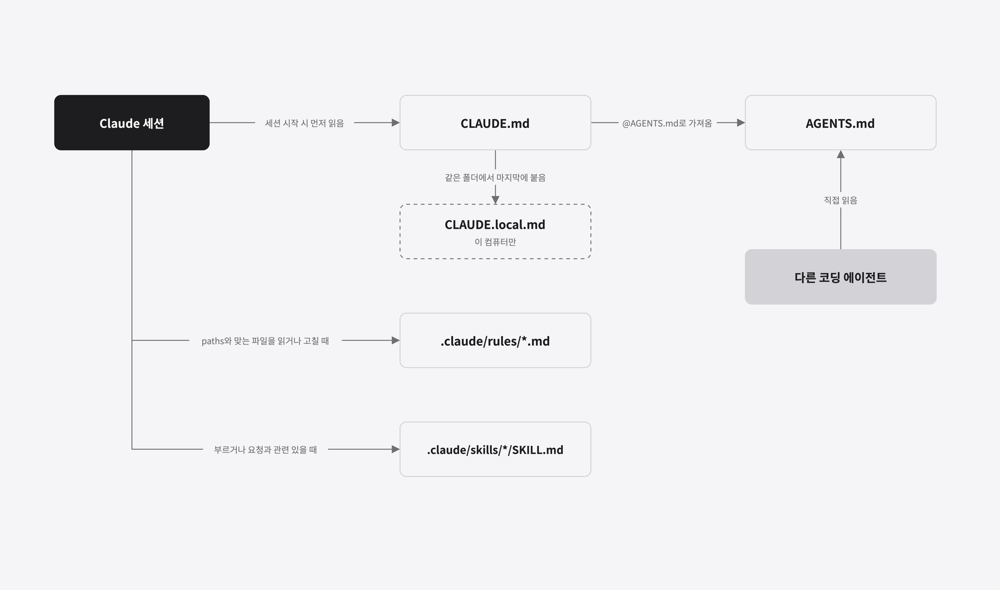
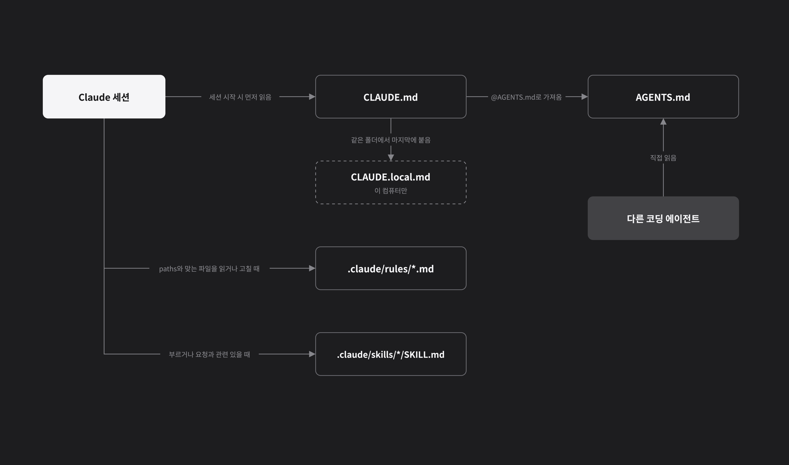
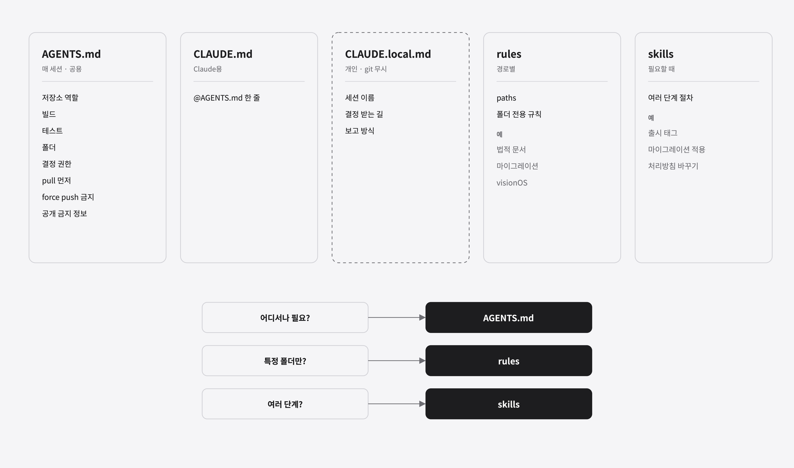
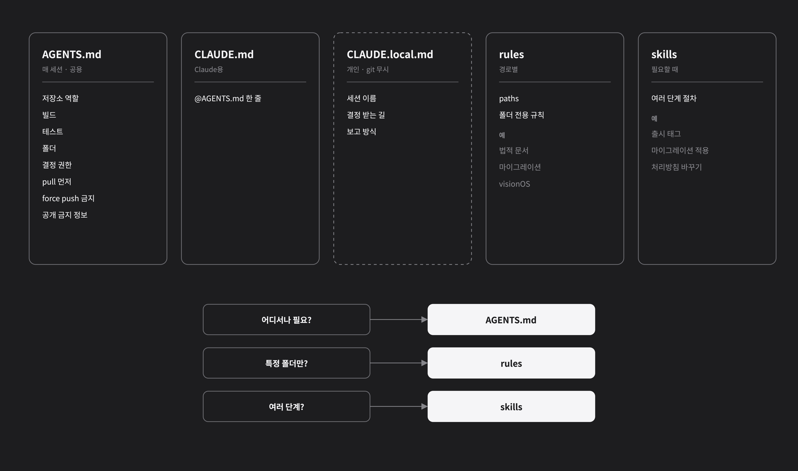
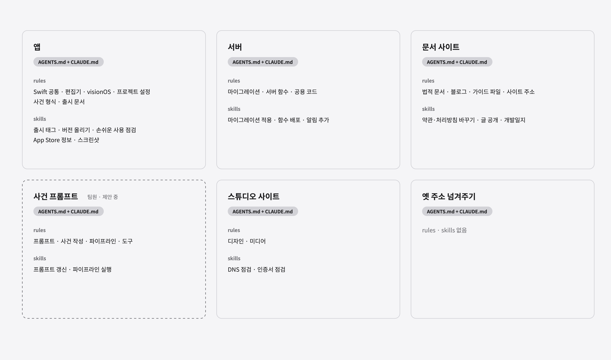
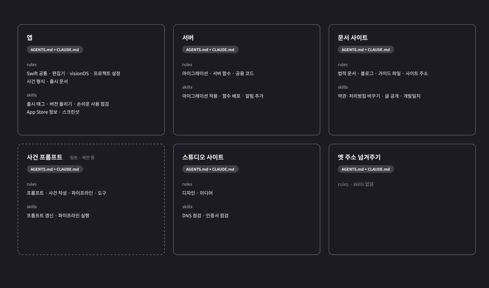

## 개요

Claude Academy에서 Claude Code를 처음부터 다시 공부하다가 [How Claude remembers your project](https://code.claude.com/docs/en/memory) 문서를 읽었습니다. 이 문서는 Claude Code가 세션을 시작할 때 무엇을 읽고, 작업 중에 무엇을 더 읽는지 설명합니다.

Casebook은 여러 저장소를 여러 Claude Code 세션이 나눠 맡고, 최근에는 다른 도구를 쓰는 팀원도 함께 작업합니다. 문서를 읽고 나니 지금 규칙이 놓인 방식으로는 협업이 어렵겠다는 생각이 들었습니다. 그래서 PM 역할을 하는 Claude 세션에 문서 내용을 각 저장소에 적용하라고 요청했습니다.

이 글은 그 결과로 여섯 개 저장소의 규칙을 `AGENTS.md`, `.claude/rules/`, `.claude/skills/` 세 곳에 나눈 기준을 정리합니다.

## 정리하기 전의 문제

| 문제 | 결과 |
|---|---|
| 규칙이 README, `CLAUDE.md`, 한 컴퓨터의 Claude 메모리에 흩어져 있음 | 같은 규칙이 여러 곳에 있어서, 한쪽만 고쳐지는 일이 생김 |
| 개인 메모리에만 있는 규칙이 있음 | 팀원의 도구는 그 규칙을 읽을 수 없음 |
| 모든 규칙이 한 파일에 있음 | 문서 사이트의 블로그 규칙을 서버 작업 중에도 읽음 |

## 세 가지 파일의 역할

### AGENTS.md: 매 세션 읽는 공용 규칙

Claude Code 문서에 따르면 Claude Code는 저장소의 `AGENTS.md`를 프로젝트 지침으로 읽을 수 있습니다. 다른 코딩 에이전트를 위해 만든 저장소도 따로 설정하지 않고 쓸 수 있게 하려는 것입니다.

다만 조건이 있습니다. 작업 폴더나 그 위에 `CLAUDE.md`, `.claude/CLAUDE.md`, `CLAUDE.local.md` 중 하나라도 있으면, Claude Code는 기본으로 `CLAUDE.md` 쪽만 읽고 `AGENTS.md`는 읽지 않습니다.

| 저장소에 있는 파일 | Claude Code가 읽는 것 |
|---|---|
| `AGENTS.md`만 | `AGENTS.md` |
| `AGENTS.md`와 `CLAUDE.md` | `CLAUDE.md`만 |
| `AGENTS.md`를 가져오는 `CLAUDE.md` | `CLAUDE.md`와, 가져온 `AGENTS.md` |

Casebook은 세 번째 방식을 골랐습니다. 규칙의 원본은 `AGENTS.md` 하나로 두고, `CLAUDE.md`에는 그 파일을 가져오는 한 줄만 둡니다.

```markdown
@AGENTS.md
```

`@경로`로 가져온 파일은 세션을 시작할 때 `CLAUDE.md`와 함께 펼쳐져 읽힙니다. 이렇게 하면 Claude Code는 `CLAUDE.md`를 통해, 다른 도구는 직접 같은 `AGENTS.md`를 읽습니다. 나중에 개인 파일 `CLAUDE.local.md`를 더해도 `AGENTS.md`가 빠지지 않습니다.

> **참고:** 문서는 CLAUDE.md 파일의 크기를 "target under 200 lines per CLAUDE.md file"이라고 안내합니다. 가져온 파일도 시작할 때 함께 읽히므로, `@AGENTS.md`로 나눠도 읽는 양은 줄지 않습니다. 그래서 `AGENTS.md` 자체를 100줄 아래로 맞췄습니다.

### .claude/rules/: 특정 경로에서만 읽는 규칙

`.claude/rules/` 폴더의 파일 맨 위에 `paths`로 경로 패턴을 적으면, 그 규칙은 Claude가 해당 경로의 파일을 읽거나 고칠 때만 읽힙니다. `paths`가 없는 규칙은 매 세션 읽힙니다.

```markdown
---
paths:
  - "src/pages/privacy.astro"
  - "src/pages/terms.astro"
---

# 법적 문서
- 시행일은 세 곳을 함께 고친다
```

### .claude/skills/: 필요할 때만 읽는 절차

문서는 rules가 매 세션 또는 해당 파일을 열 때 읽힌다고 설명합니다. 특정 작업에만 필요한 지침은 skills에 두라고 안내합니다. skill은 사용자가 부르거나, Claude가 지금 요청과 관련 있다고 판단할 때만 읽힙니다.

### 읽히는 순서




## 어떤 규칙을 어디에 둘지 정한 기준

문서는 `CLAUDE.md`에 매 세션 알아야 할 사실만 두라고 합니다. 빌드 명령, 규칙, 폴더 구조 같은 것입니다. 여러 단계로 된 절차나 코드의 일부에만 해당하는 내용은 skill이나 경로별 규칙으로 옮기라고 안내합니다. 이 안내를 세 가지 질문으로 바꿔 규칙 하나하나에 적용했습니다.

| 질문 | 그렇다면 |
|---|---|
| 어느 파일을 고치든 알아야 하는가? | `AGENTS.md` |
| 특정 폴더의 파일을 고칠 때만 필요한가? | `.claude/rules/` (`paths` 지정) |
| 순서가 있는 여러 단계 작업인가? | `.claude/skills/` |

예를 들어 "푸시하기 전에 원격 저장소의 최신 내용을 받는다"는 어느 파일을 고치든 지켜야 하므로 `AGENTS.md`에 둡니다. "처리방침의 시행일은 세 곳을 함께 고친다"는 처리방침 페이지를 고칠 때만 필요하므로 경로별 규칙에 둡니다. "출시된 버전에 태그를 달고 백로그를 마무리한다"는 순서가 있는 절차라서 skill로 만듭니다.

두 단계뿐인 짧은 절차는 skill로 만들지 않고 경로별 규칙에 한 줄로 적었습니다. skill은 절차가 길어서 매번 읽기에는 부담스러울 때 의미가 있다고 봤습니다.




## 저장소별 구성

여섯 개 저장소는 하는 일이 달라서, 경로별 규칙과 skill의 수도 다릅니다. 옛 주소를 넘겨주는 저장소처럼 파일이 몇 개뿐인 곳은 `AGENTS.md`와 `CLAUDE.md`만 두고, 경로별 규칙과 skill은 만들지 않았습니다.




## 공용 규칙과 개인 규칙 나누기

초안을 검토하다가, 이 컴퓨터의 Claude 세션끼리 결정을 주고받는 방식처럼 운영자에게만 필요한 규칙이 공용 파일에 섞여 있는 것을 발견했습니다. 공용 파일에 두면 팀원의 도구도 맞지 않는 규칙을 따르게 됩니다.

문서는 이런 개인 지침을 프로젝트 루트의 `CLAUDE.local.md`에 두고, `.gitignore`에 넣어 커밋하지 않게 하라고 안내합니다. 같은 폴더에서 `CLAUDE.local.md`는 `CLAUDE.md` 다음에 붙어서, 그 단계에서 가장 마지막에 읽힙니다.

| 파일 | 저장소에 올라가나 | 누가 읽나 |
|---|---|---|
| `AGENTS.md` | 올라감 | 모든 코딩 에이전트 |
| `CLAUDE.md` | 올라감 | Claude Code |
| `CLAUDE.local.md` | 올라가지 않음 | 이 컴퓨터의 Claude Code |

공용 파일에는 "운영자의 결정을 받는다"처럼 누구에게나 맞는 말만 남겼습니다. 개인 파일을 두는 저장소의 `.gitignore`에는 `CLAUDE.local.md`를 넣었고, 이번에 정리한 모든 저장소에는 Claude Code가 작업 중에 만드는 `.claude/*.lock`도 넣었습니다.

> **중요:** `CLAUDE.local.md`도 "`CLAUDE.md`가 있으면 `AGENTS.md`를 읽지 않는다"는 판단에 포함됩니다. `AGENTS.md`만 두고 `CLAUDE.local.md`를 더하면, 그때부터 Claude Code가 `AGENTS.md`를 읽지 않습니다. `CLAUDE.md`에서 `@AGENTS.md`로 가져오는 방식을 고른 이유이기도 합니다.

## 적용하기

| 단계 | 한 일 |
|---|---|
| 초안 | 저장소를 맡은 세션이 각자 초안과 근거를 작성 |
| 검토 | 운영자가 파일을 하나씩 읽고, 이해가 안 되는 문장은 예시를 넣어 다시 씀 |
| 반영 | 운영자가 맡은 다섯 저장소에 커밋 |
| 제안 | 팀원이 맡은 저장소에는 이슈로 같은 구성을 제안 |

검토 중에 빠진 규칙과 필요 없는 규칙도 찾았습니다. 문서 사이트를 옮긴 뒤로는 의미가 없어진 규칙 하나를 지웠고, 로고 영상을 다시 만드는 명령에는 빠져 있던 단계 세 개를 채웠습니다. 채운 명령은 실제로 다시 실행해 지금 파일과 같은 결과가 나오는지 확인했습니다.

## 결과

| 항목 | 결과 |
|---|---|
| `AGENTS.md` | 다섯 개 저장소에 반영, 팀원 저장소는 제안 중. 모두 100줄 아래 |
| 경로별 규칙 | 15개 (팀원 저장소에 제안한 4개 제외) |
| skill | 12개 (팀원 저장소에 제안한 2개 제외) |
| 개인 규칙 | `CLAUDE.local.md`로 분리, 저장소에 올리지 않음 |

이제 팀원의 도구도 같은 공용 규칙을 읽습니다. 서버 작업을 할 때는 블로그 규칙을 읽지 않고, 블로그를 고칠 때는 마이그레이션 규칙을 읽지 않습니다.
