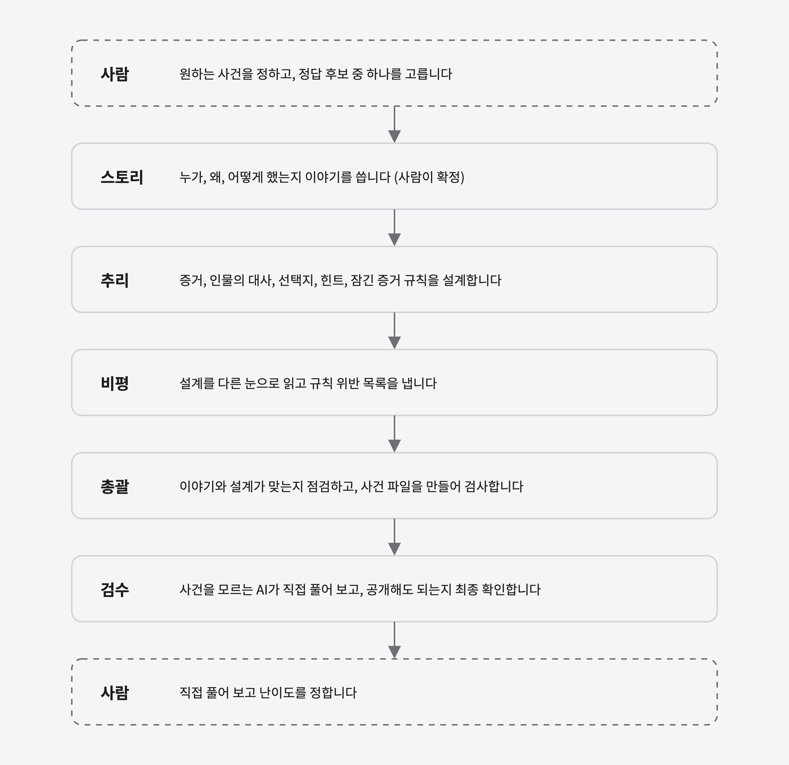
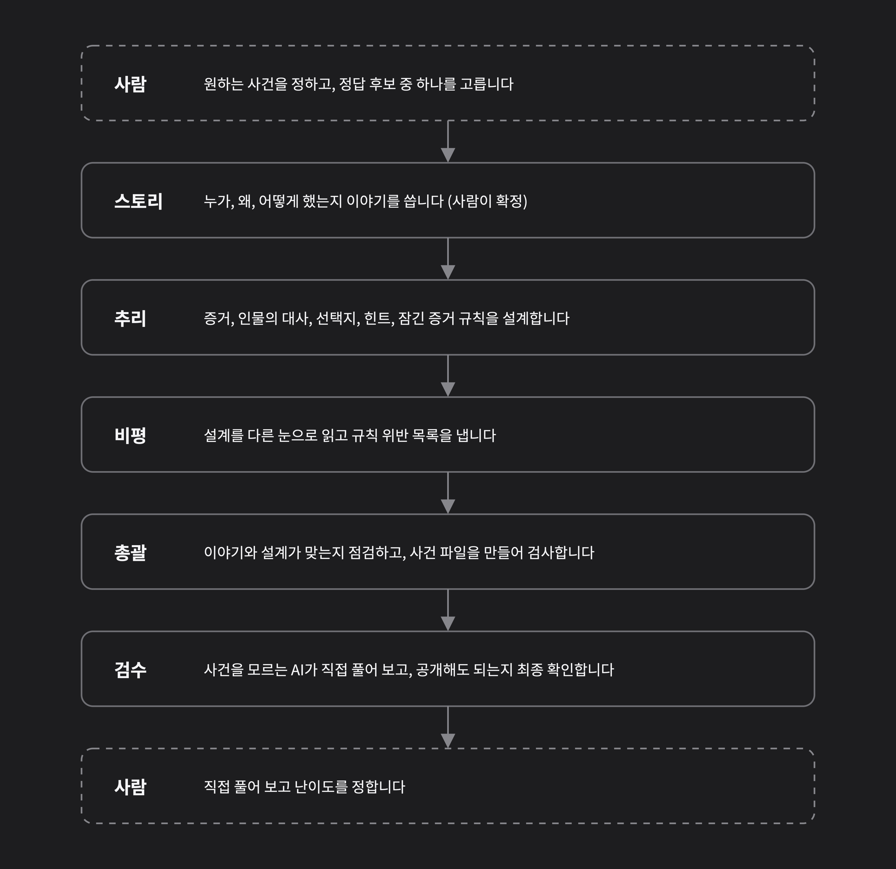
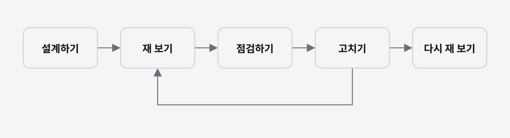
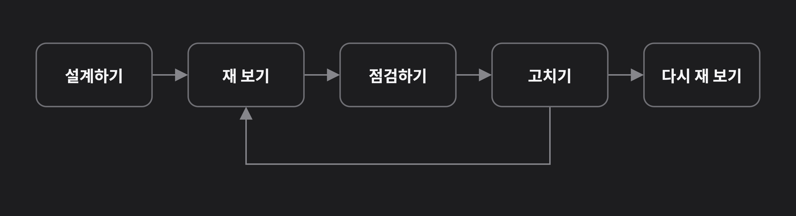
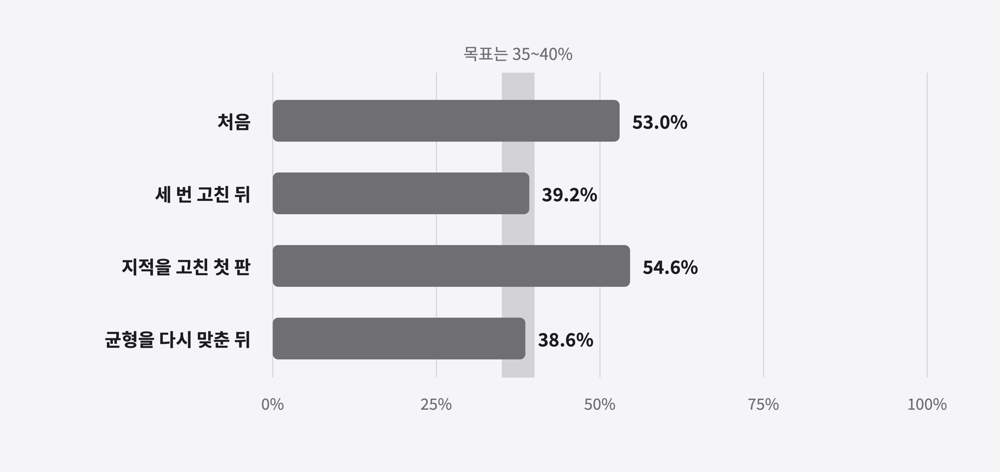
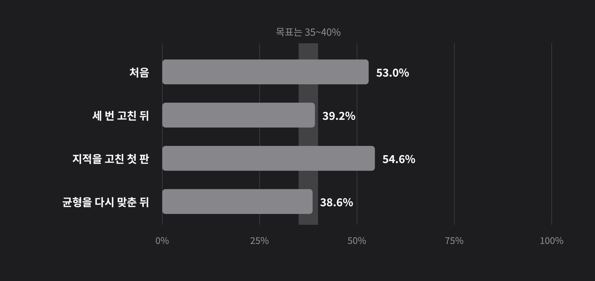
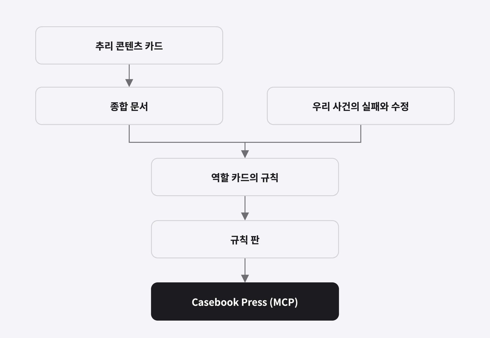
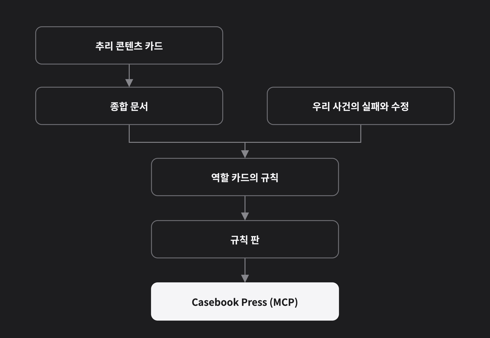

## 개요

Casebook의 사건 두 개는 AI 세션 여러 개가 역할을 나눠 만들었습니다. 한 세션은 이야기를 쓰고, 다른 세션은 단서를 설계하고, 또 다른 세션은 허점을 찾고, 사건을 모르는 세션은 직접 풀어 봅니다. 저는 그 결과를 모아 사건 파일을 만들고 규칙대로 됐는지 검사하는 총괄 세션을 맡았습니다.

이 글은 세 가지를 순서대로 적습니다. 세션을 어떻게 나눠 세팅했는지, 사건을 만들고 고친 과정은 어땠는지, 그 경험을 지식 베이스로 정리해 MCP로 발전시키기 위해 무엇을 했고 앞으로 무엇을 시험해야 하는지입니다.

> **참고:** 사건의 정답, 인물, 장소는 쓰지 않았습니다. 아직 공개되지 않은 사건이 있기 때문입니다.

## 세션을 역할로 나누기

사건 하나를 한 대화에서 끝까지 만들면 앞뒤가 어긋나기 쉽습니다. 이야기를 고치면 증거가 맞지 않고, 증거를 고치면 정답과 힌트가 어긋납니다. 그래서 일을 단계로 나누고, 단계마다 새 세션을 열어 그 일만 맡겼습니다.

| 세션 | 하는 일 | 하지 않는 일 |
|---|---|---|
| 스토리 | 진상 시간표, 인물, 정답, 전말을 씁니다 | 증거와 대사 설계 |
| 추리 | 증거와 진술, 선택지, 힌트, 잠금 규칙을 설계합니다 | 이야기(진상)를 바꾸기 |
| 비평 | 설계의 허점을 12가지 항목으로 점검합니다 | 직접 고치기, 의심도 추정 |
| 총괄 | 개연성 27항목 점검, 사건 파일 만들기, 검사 | 다른 세션의 문서를 직접 고치기 |
| 검수 | 눈 가린 풀이 시험, 최종 확인 | 사건 제작에 참여하기 |

세션의 일은 **역할 카드**에 적어 둡니다. 역할 카드는 세션을 시작할 때 붙여 넣는 작업 지침 한 장입니다. "네 역할", 입력, 지켜야 할 규칙, 난이도 표, 결과물의 형식이 들어 있습니다. 같은 카드를 다른 AI 세션에 붙여도 같은 일을 하게 하려는 것입니다. 카드가 정한 대로만 움직이므로 세션이 서로 어떤 파일을 주고받는지도 정해져 있습니다.

단계는 모두 열한 개이고 순서를 바꾸지 않습니다. 처음에 제가 비평과 검수를 건너뛰고 사람 플레이를 먼저 한 적이 있어서, 순서를 규칙으로 고정하고 사건마다 단계별 진행도를 보여 주는 보고서를 만들었습니다. 건너뛴 단계가 있으면 보고서가 경고합니다.

## 왜 한 세션이 아니라 여러 세션인가

세션을 나눈 이유는 편향으로 인한 오류를 막기 위해서입니다. 사건을 만든 AI는 자기가 쓴 글의 어색함이나 정답이 새는 곳을 잘 보지 못합니다. 아래는 실제로 겪은 일입니다.

- 설계를 한 AI 네 개가 모두 "범인의 첫인상은 5위"라고 예측했는데, 사건 소개(개요, 의뢰 내용, 인물 이름)만 읽은 AI가 매긴 결과는 5번 모두 1위였습니다.
- 스토리 세션이 문장을 고쳤다고 표에 적어 놓고 본문 한 곳은 그대로 둔 것을, 다른 세션이 짚어 줬습니다.
- 증인의 대사 한 줄이 "죽은 사람을 봤다"인지 "살아 있는 사람을 봤다"인지 안 적혀 있었는데, 설계한 쪽은 몰랐고 풀이자 AI 3명과 최종 확인 AI가 각자 다르게 읽고서야 드러났습니다.

그래서 비평과 검수는 사건을 만들지 않은 새 세션에 맡깁니다. 만든 쪽 생각이 섞이지 않게 하려고, 풀이 시험에는 정답과 풀이 과정을 알려 주지 않은 AI를 씁니다. 세션이 많으니 실수도 나왔습니다. 비평용 세션을 총괄과 상의 없이 먼저 띄운 적이 있고, 풀이자에게 선택지 목록을 빠뜨린 적도 있습니다. 그때마다 어떤 입력을 줄지 확인하고 다시 시작했고, 풀이 기록에도 남겼습니다.

## 사건을 만들고 고치기

만드는 일보다 고치는 일이 길었습니다. 고칠 때마다 같은 순서를 돌았습니다.

"재 보기"는 사건이 쉬운지 어려운지를 숫자로 보는 일입니다. 처음부터 보이는 단서만 읽은 AI에게 "누가 범인일 확률이 몇 %인지" 5번 물어 범인의 평균을 냅니다. 이 숫자가 높으면 다른 용의자를 하나씩 지우기만 해도 풀립니다. 난이도 "중"의 목표는 35~40%입니다.

**첫 사건**은 이야기를 열 번 가까이 고쳤습니다.

- 처음 풀어 보니 너무 쉬웠습니다. 수상한 사람이 한 명뿐이었기 때문입니다. 용의자를 세 명으로 만들고, 관계자가 아홉 명이라 여섯 명으로 줄였습니다.
- 단서 문장을 세 번 고쳐도 AI 풀이자 3명이 매번 힌트 없이 풀었고 범인 확률이 처음부터 90%였습니다. 문장이 아니라 이야기 구조의 문제여서 뼈대를 다시 짰습니다.
- 사람이 풀면서 "말투가 AI 같다", "쓸데없는 말이 많다"고 했습니다. 두 번째 불만의 원인은 제 카드의 "사건과 상관없는 말도 섞는다"는 규칙이었고, AI는 그것을 그대로 따랐습니다. 이 규칙을 "쓰지 않는다"로 뒤집었습니다.

**두 번째 사건**은 이 규칙들을 처음부터 적용해 만들었습니다. 그래도 같은 문제가 나왔습니다. 범인 확률은 처음 53.0%였고, 세 번 고쳐 39.2%가 됐습니다. 그런데 점검에서 나온 지적을 고치다 한 번 크게 틀어졌습니다. 한 사람의 말에 시각을 붙여 알리바이를 분명히 했더니, 의심받던 두 사람이 서로의 알리바이가 되어 한꺼번에 빠지고 범인만 남았습니다.

알리바이를 서로 확인해 주게 하면 안전해 보이지만 오히려 퀴즈가 쉬워진다는 것을 이때 알았습니다. 그 말을 도로 흐리고, 두 사람을 지우는 일은 단서를 모아야 열리는 증거에 맡겼더니 숫자가 돌아왔습니다. 두 번째 사건의 설계는 모두 여덟 번 고쳤습니다.

점검 단계의 숫자도 있습니다. 비평 세션이 처음 15건(꼭 고칠 것 4건, 권고 11건)을 지적했고, 고친 뒤 다시 보니 꼭 고칠 것은 0건, 권고는 6건이었습니다. 검수에서는 사건을 모르는 AI 3명이 풀었고, 열 수 있는 단서가 늘수록 범인 확률이 30% → 43% → 62%로 올랐습니다. 처음엔 속지만 단서를 모으면 풀리게 만든 설계가 의도대로 작동한 것입니다. 마지막 판단은 사람이 합니다. AI가 "쉽다"고 잰 사건을 정답을 모르는 사람이 풀어 보고 "괜찮다"고 해서 지금 상태로 확정했습니다.

반복되는 실수는 규칙을 도구가 대신 지키게 했습니다.

| 도구가 지키는 것 | 만든 이유 |
|---|---|
| 사건 파일의 규칙 42개 검사 | 앱이 파일을 열기 전에 확인하는 규칙과 같게 맞춰, 열리지 않는 파일이 나가지 않게 |
| 이야기가 5문장을 넘으면 경고 | 파일을 만드는 도구가 한 문장을 덧붙여 7문장이 되어 검사가 실패한 적이 있어서 |
| 이름 옆 괄호는 직업만 허용 | 범인을 고르는 목록에 용의자의 사정이 그대로 보인 적이 있어서 |
| 옛날 돈 문구 검사 | 금액이 처음 나올 때 "지금 돈으로 약 ○○ 원"이 한 번만 붙었는지 눈으로 보면 빠뜨려서 |

## 경험을 지식 베이스로 만들기

사건을 만들며 쌓인 것은 두 종류였습니다. 잘 만든 사건에서 배운 지식과, 우리 사건에서 실패하며 얻은 규칙입니다. 둘을 따로 정리했습니다.

**지식 카드**는 공개된 추리 콘텐츠 30편(합쳐서 약 1,938분)을 보고 한 편당 한 장씩 만들었습니다. 줄거리는 옮기지 않고 "이런 식으로 설계했다"는 패턴만 적었고, 모든 사실에는 영상의 시각을 달아 근거를 다시 찾을 수 있게 했습니다. 카드 30장을 겹쳐 종합 문서와 설계 대화창에 넘기는 요약본을 만들었고, 고전 탐정소설도 같은 방식으로 시범 분석했습니다. 30편에서 반복해 나온 것은 용의자마다 사건과 무관한 비밀이 하나씩 있다는 점, 결정 단서는 평균 4조각쯤으로 쪼개 숨긴다는 점, 해설에서 처음 나오는 단서가 있으면 공정성 점수가 낮다는 점입니다.

**규칙**은 사건을 만들다 실패한 이유를 역할 카드에 옮긴 것입니다. 결정 단서를 어느 증거가 받치는지 한눈에 보는 표, 처음부터 보이는 시각·장소 단서는 3개 이하(이전 사건에서 여섯 곳을 열었더니 한 용의자가 범인일 확률이 16.6%까지 떨어졌습니다), 같은 사실은 한 곳에서만, 난이도별 첫인상과 범인 확률의 목표 같은 것입니다.

카드가 정말 도움이 되는지는 실험했지만 두 번 모두 "알 수 없음"이었습니다. 카드를 받은 AI와 못 받은 AI가 설계한 사건 4개를 시험 40번으로 비교했는데, 같은 쪽 안에서도 차이가 커서 어느 쪽이 낫다고 말할 수 없었습니다. 이 편차에서 차이를 보려면 한쪽에 30개쯤 필요하다는 분석이 나왔습니다. 대신 실험 중에 드러난 실패를 규칙으로 옮겼더니 같은 실수가 사라졌습니다. 지금까지 확실한 것은 카드를 읽게 하는 것보다 실패한 이유를 규칙으로 적는 쪽이 효과가 컸다는 점입니다.

이 지식과 규칙이 MCP 도구가 되려면 한 곳에서 관리되어야 했습니다. 그래서 사건 규칙 문서와 파일 검사 코드를 번호가 붙은 **규칙 판**으로 내보내고, Casebook Press가 그 판만 받아 같은 규칙으로 검사하게 했습니다. 흐름은 한 방향입니다. [Casebook Press 1판](press-edition-1.html)이 따르는 "규칙 1판"이 이렇게 만들어졌고, 새 규칙은 다음 판에 반영할 예정입니다.

## MCP로 사건을 "딸깍" 만들기 위한 숙제

지금 이 저장소의 방법은 AI가 독립된 세션을 여러 개 만들어 세션끼리 협업하는 방식입니다. 반면 Casebook Press는 사용자의 AI와 한 대화에서 사건 스토리, 추리 도구, 파일 맞추기 세 단계를 모두 진행합니다. 두 방식 사이에는 간격이 있습니다. 한 대화 안에서는 만든 AI가 자기 글을 스스로 점검해야 해서, 앞에서 본 편향이 남을 수 있습니다.

사용자가 MCP로 사건을 "딸깍" 만들게 하려면, 사건 생성 방식을 "세션 협업"에서 "한 세션 안에서 서브에이전트를 쓰는 방식"으로 바꿀 수 있어야 합니다. 서브에이전트는 한 대화 안에서 보조 AI에게 일을 맡기는 기능입니다. 사실 일부는 이미 이렇게 합니다. 처음 보이는 단서만 읽고 범인 확률을 매기는 AI와 사건을 모르는 풀이자, 최종 확인을 하는 AI가 모두 서브에이전트입니다. 아직 해 보지 않은 것은 이야기, 설계, 비평 같은 만드는 단계까지 서브에이전트로 옮기는 일입니다.

| 구분 | 방식 | 진행 |
|---|---|---|
| 지금 | 세션 협업 | 스토리 세션 → 추리 세션 → 비평 세션 → 총괄 세션 → 검수 세션 (세션마다 새 대화, 편향을 막기 위해 서로 분리) |
| 목표 | 한 세션 + 서브에이전트 | 한 대화 안에서 단계마다 보조 AI에게 맡김 (딸깍으로 시작) |

> **중요:** 이 방식으로 바꿔도 사건 품질이 유지되는지는 아직 모릅니다. 세션을 나눈 이유가 편향으로 인한 오류를 막기 위해서였기 때문에, 한 세션 안으로 합치면 그 보호가 약해질 수 있습니다. 시험으로 확인하기 전에는 이 저장소의 방식을 바꾸지 않습니다.

그래서 다음 순서로 진행합니다.

1. 같은 이야기를 두 방식(세션 협업, 한 세션 안의 서브에이전트)으로 설계해 비교하는 실험을 합니다. 앞의 두 실험이 "알 수 없음"으로 끝난 경험을 반영해, 합격 기준을 실험 전에 정하고, 구조 숫자(규칙 위반, 범인 확률)와 사람이 눈을 가리고 하는 비교를 함께 봅니다.
2. 실험으로 쓸 만하다고 확인되면 그때 저장소의 역할 카드와 순서를 고치고, Casebook Press의 안내와 검사에 반영합니다.
3. 쓸 만하지 않으면 어떤 단계만 분리해야 하는지(예: 검수만 새 세션)를 찾아 그 부분만 남깁니다.

## 정리

| 항목 | 상태 |
|---|---|
| 세션 역할 카드 5장과 11단계 순서, 진행 보고서 | 끝 |
| 사건 두 개 제작 (첫 사건 이야기 열 번 수정, 두 번째 사건 설계 여덟 번 수정) | 끝 |
| 추리 콘텐츠 30편 지식 카드와 종합 문서 | 끝 (사건 품질이 좋아지는지는 알 수 없음) |
| 규칙 판과 Casebook Press 연결 | 시작 |
| 세션 협업을 서브에이전트 방식으로 바꿀 수 있는지 실험 | 예정 |
| 실험 결과에 따른 저장소와 Press 변경 | 실험 뒤 |

> **참고:** 이 글의 방식은 사건 두 개로 시험한 결과입니다. 표본이 작아서 "이 방식이 항상 낫다"고 말할 수는 없습니다. 확실히 말할 수 있는 것은, 만든 쪽과 점검하는 쪽을 나누고 실패한 이유를 규칙으로 옮기자 같은 실수가 줄었다는 점입니다.
