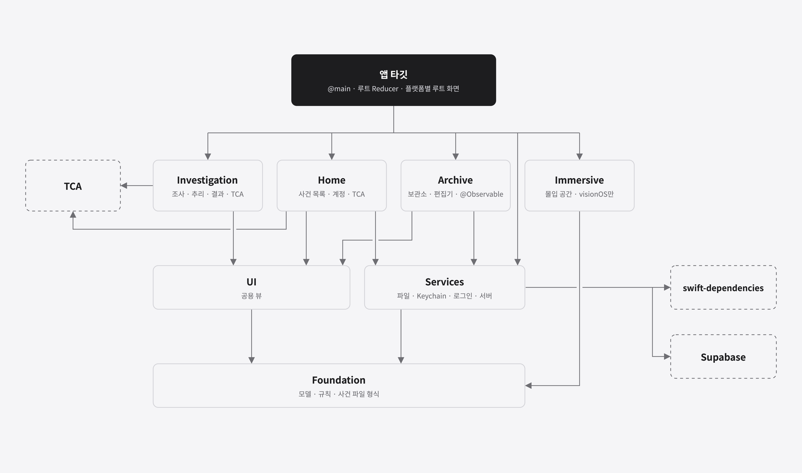
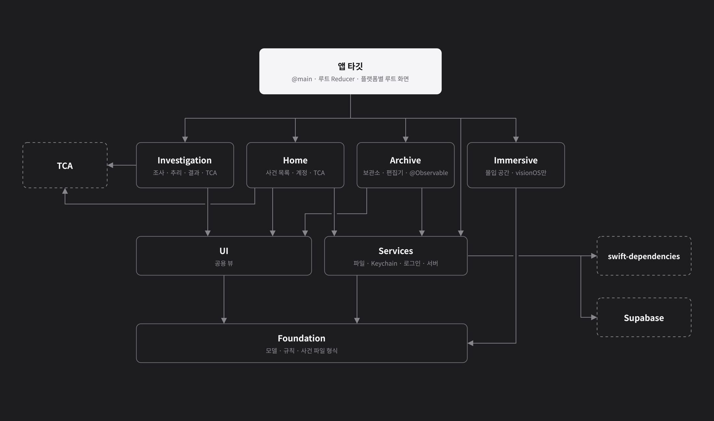
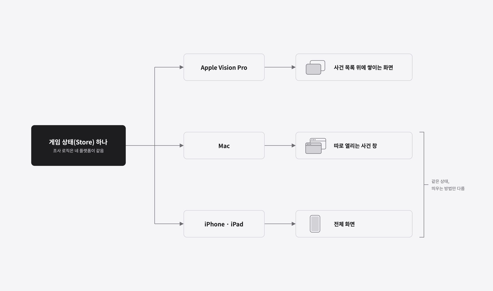
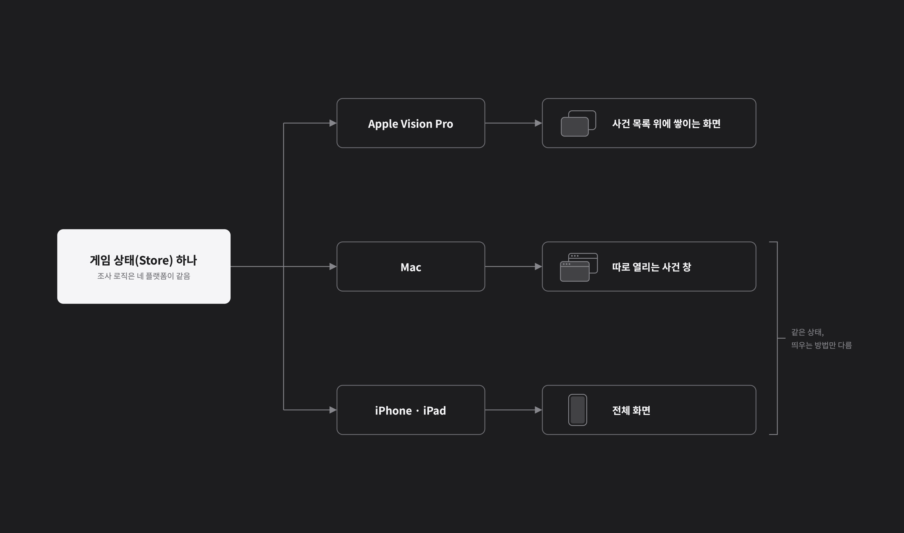

## 개요

Casebook은 iPhone, iPad, Mac, Apple Vision Pro에서 같은 번들 ID로 배포하는 앱입니다. 앱 타깃은 하나이고, 코드는 대부분 로컬 Swift 패키지 하나에 들어 있습니다. 앱 타깃에는 `@main`, 루트 Reducer, 플랫폼별 루트 화면만 남깁니다.

이 글에서는 그 패키지를 Module 일곱 개로 나눈 기준과, Module끼리 서로 모르게 하는 방법, 플랫폼 차이를 한곳에 모으는 방법을 정리합니다. 마지막으로 다른 팀이 공개한 모듈화 글을 읽고, 우리 앱에 맞는지 하나씩 따져 본 결과를 함께 적습니다.

> **참고:** 이 글은 앱 코드 구조만 다룹니다. 앱 · 서버 · 운영 도구 · 배포 파이프라인 전체 구조는 [1편](how-casebook-is-built.html)에 있습니다.

## 전체 구조 보기

패키지는 아래쪽은 가로로, 위쪽은 세로로 나눕니다.




| 층 | Module | 하는 일 |
|---|---|---|
| Model | `CasebookFoundation` | 사건 모델, 채점, 검증, 장르, 증거 해금 규칙, 사건 파일 형식. UI와 부수효과가 없습니다 |
| Service | `CasebookServices` | 파일, Keychain, Apple로 로그인, 공공 사건기록보관소 서버처럼 바깥 세계와 이야기하는 Dependency |
| 공용 UI | `CasebookUI` | 사건 이미지, 인물 사진, 로그인 안내처럼 여러 기능이 같이 쓰는 작은 뷰 |
| Feature | `CasebookHome` | 사건 목록과 계정(TCA) |
| Feature | `CasebookInvestigation` | 증거 · 인터뷰 · 추리 · 결과(TCA) |
| Feature | `CasebookImmersive` | 증거를 주변에 띄우는 몰입 공간(visionOS) |
| Feature | `CasebookArchive` | 홈 · 검색 · 나의 사건 · 둘러보기 · 사건 편집기 · 프로필(`@Observable`) |

앱이 연결하는 단위는 Module이 아니라 패키지의 product 세 개입니다. 모든 플랫폼에 쓰는 것, 사건기록보관소, visionOS 전용 몰입 공간을 각각 product로 묶고, 플랫폼 전용 product는 앱이 그 플랫폼에서만 연결합니다.

```swift
products: [
    .library(name: "CasebookKit", targets: [
        "CasebookFoundation", "CasebookServices", "CasebookUI",
        "CasebookHome", "CasebookInvestigation",
    ]),
    .library(name: "CasebookArchiveKit", targets: ["CasebookArchive"]),
    .library(name: "CasebookImmersiveKit", targets: ["CasebookImmersive"]),
]
```

## 바닥은 층으로, 기능은 세로로 나누기

모델과 Service는 거의 모든 기능이 쓰는 부품이라 층으로 둡니다. 위층은 아래층만 알고, 아래층은 위층을 모릅니다. 이 방향은 `Package.swift`의 `dependencies`로 정해지므로, 잘못된 `import`는 컴파일 오류가 됩니다.

기능은 세로로 나눕니다. TCA에서 Reducer와 그 화면은 거의 한 몸이라, 기능 하나를 고칠 때 Module 하나만 고치게 묶었습니다. 예를 들어 조사 화면을 고치면 `CasebookInvestigation`만 바뀝니다.

> **참고:** 기능 Module 이름에는 `Feature`를 붙이지 않습니다. Module 안의 Reducer 타입이 이미 `CaseSelectionFeature`처럼 `Feature`로 끝나서, 둘의 이름이 같아지면 어느 쪽을 가리키는지 헷갈리기 때문입니다.

## 기능 Module끼리 서로 모르게 하기

기능 Module은 서로 `import`하지 않습니다. 보관소에서 사건을 고르면 조사 화면이 열려야 하는데, `CasebookArchive`는 `CasebookInvestigation`을 모릅니다. 대신 "이 사건을 시작해 주세요"라는 요청만 앱에 넘깁니다.

```swift
public enum CasePlayRequest: Hashable, Sendable {
    case builtIn(CaseFile.ID)
    case file(URL)
    case imported(CaseFile.ID)
}
```

앱 타깃이 이 요청을 받아 루트 Reducer에 보내고, 루트 Reducer가 조사 화면을 엽니다. 보관소는 사건이 어떤 창에서 어떻게 열리는지 모르고, 조사 화면은 사건이 어디서 왔는지 모릅니다.

TCA 안에서도 같은 원칙을 씁니다. 자식 Reducer는 부모를 모르고 `delegate` 액션만 보냅니다. 추리가 해결 기준을 넘으면 조사 화면은 "해결했다"는 delegate 액션만 보내고, 해결 기록을 남기는 일은 루트 Reducer가 맡습니다.

## TCA와 @Observable을 함께 쓰기

게임 쪽(사건 목록, 조사, 추리)은 TCA로 만들었습니다. 상태가 화면 사이를 오가고, 해금 진행과 채점처럼 테스트로 지켜야 하는 흐름이 많기 때문입니다.

사건기록보관소는 TCA 없이 `@Observable` 모델 몇 개로 만들었습니다.
- 사건 편집기는 문서 값을 SwiftUI `Binding`으로 직접 고치고, 저장과 실행 취소는 Mac의 문서 창이 맡습니다. 이 흐름에는 별도 Store보다 바인딩이 잘 맞습니다.
- 보관소는 화면 수에 비해 상태가 단순합니다. 대부분 목록을 읽고 쓰는 일입니다.

두 방식이 같은 Service를 쓰도록, Service Module은 TCA 전체가 아니라 그 안의 Dependency 도구(`swift-dependencies`)에만 의존합니다.

```swift
@DependencyClient
public struct SolvedCaseClient: Sendable {
    public var load: @Sendable () -> [SolvedCaseRecord] = { [] }
    public var record: @Sendable (_ caseFile: CaseFile, _ score: Int) async -> Void
    public var updates: @Sendable () -> AsyncStream<[SolvedCaseRecord]> = { .finished }
}
```

Reducer는 `@Dependency`로 받고, 테스트와 미리보기에서는 다른 구현으로 바꿔 끼웁니다. 실제 구현(`liveValue`)과 미리보기 구현(`previewValue`)을 같은 자리에 둡니다.

## 플랫폼 차이를 한곳에 모으기

플랫폼마다 사건 화면을 띄우는 방법이 다릅니다.




| 플랫폼 | 사건 화면 | 상태 |
|---|---|---|
| Apple Vision Pro | 사건 목록 위에 쌓이는 화면(스택) | `StackState` |
| Mac | 따로 열리는 사건 창 | `@Presents` |
| iPhone · iPad | 전체 화면 | 같은 `@Presents` |

게임 상태(Store)는 앱 전체에 하나만 둡니다. Mac과 iPhone · iPad는 같은 상태를 쓰고 **띄우는 방법만** 다르므로, Reducer는 두 갈래(스택 / 표시)면 충분합니다. 조사 화면의 로직은 네 플랫폼이 같습니다.

패키지 안의 화면 코드는 되도록 플랫폼을 모르게 하고, 차이는 몇 곳에만 모았습니다.
- 이미지 타입(`NSImage` / `UIImage`)은 타입 별칭 하나로 감춥니다.
- 편집기를 여는 방법(Mac은 문서 창, iPhone · iPad는 전체 화면)은 Environment 값 하나로 감춥니다. 화면은 "이 파일을 편집기로 열어 주세요"만 부릅니다.
- 버튼 스타일(Mac · iOS는 Liquid Glass, visionOS는 기본 버튼)은 수정자 하나로 감춥니다.

> **중요:** `#if os(...)`를 화면 곳곳에 흩으면 플랫폼이 늘 때마다 모든 화면을 다시 봐야 합니다. 차이가 생기면 먼저 위 자리 중 하나에 넣을 수 있는지 봅니다.

## 테스트를 패키지에서 돌리기

테스트는 앱이 아니라 패키지 타깃에만 의존합니다. 그래서 Mac에서 시뮬레이터 없이 `swift test`로 돌립니다.
- 규칙(채점, 힌트, 검증, 사건 파일 형식, 증거 해금 등)은 Swift Testing으로 시험합니다.
- 서버 응답을 해석하는 부분은 실제 모양의 응답을 넣어 시험합니다.
- 조사 화면의 흐름(정답 제출 → 결과, 단서 확인 → 잠긴 증거 열기)은 TCA의 `TestStore`로 시험합니다.

지금 테스트는 100개 남짓이고, 몇 초 안에 끝납니다.

## 다른 팀의 모듈화 방식과 비교하기

에브리타임 iOS 팀이 공개한 [모듈화 글](https://www.vinuteam.com/blog/66)을 읽고, 글에 나온 방식이 우리 앱에도 필요한지 하나씩 따져 봤습니다. 그 팀은 13년 된 단일 앱 타깃을 나누는 중이고, 우리 앱은 처음부터 패키지로 시작한 작은 앱이라 출발점이 다릅니다.

| 글의 방식 | 우리 판단 | 이유 |
|---|---|---|
| 의존 방향(Shared → Core → Feature → App)을 지키고, 역방향 의존을 설계 신호로 보기 | **이미 같음** | 층과 방향을 `Package.swift`가 강제합니다 |
| Feature마다 Interface · 구현 · Testing · Tests · Example 다섯 타깃 | **그대로 따르지 않음** | 우리 기능 Module은 넷이고 서로 `import`하지 않습니다. 기능 사이의 연결은 앱 타깃이 요청 값(`CasePlayRequest`)과 Environment 값으로 합니다. 다섯 타깃으로 나누면 타깃이 스무 개를 넘지만, 줄어드는 빌드 시간이 거의 없습니다 |
| Interface로 빌드 그래프를 끊어 재컴파일 줄이기 | **필요 없음(지금은)** | 패키지 전체 클린 빌드가 외부 패키지 포함 약 1분, 파일 하나를 고친 증분 빌드가 약 5초입니다(Apple M5 Mac, 2026년 10월 측정) |
| Interface에 Dependency protocol을 두고 미리보기에서 바꿔 끼우기 | **일부 가져옴** | 게임 쪽은 이미 `@Dependency`로 바꿔 끼웁니다. 보관소 쪽에는 정적 함수를 직접 부르는 곳이 남아 있어 같은 방식으로 옮길 예정입니다 |
| Example 앱으로 기능을 원하는 상태에서 바로 띄우기 | **각색해서 가져옴** | 기능마다 앱을 만들지 않고, 디버그 빌드에서만 켜지는 실행 옵션(가짜 보관소, 처음 열 탭 등)으로 같은 효과를 내려 합니다. 화면 확인 때마다 코드를 잠깐 바꾸던 일을 없애려는 것입니다 |
| Mock을 빌드 시점 인자로 배포 빌드에서 구조적으로 빼기 | **각색해서 가져옴** | 개발용 예시 데이터(가짜 보관소)를 배포 빌드와 분리할 예정입니다 |
| 내부 Module을 static으로 링크해 실행 시간 줄이기 | **따로 할 일 없음** | 우리 product는 링크 방식을 정하지 않은(automatic) library라 Xcode가 앱에 정적으로 넣습니다. 미리보기 때문에 dynamic이 필요한 상황도 아직 없습니다 |
| 바이너리 캐시 · scaffold | **필요 없음** | 타깃이 적고 새 Module을 만드는 일이 드뭅니다. 새 기능을 넣는 순서는 아키텍처 문서의 체크리스트로 충분합니다 |

정리하면, 글의 핵심인 "규율보다 구조로 보장한다"는 생각은 그대로 가져오고, 그 구조를 만드는 방법은 우리 규모에 맞게 줄였습니다. Interface를 따로 두는 것은 Module 사이를 끊어야 할 이유(빌드 시간, 팀 사이 병렬 작업, 서버보다 먼저 화면 만들기)가 생길 때 다시 봅니다.

## 앞으로 바꿀 것

구조를 다시 보면서 고칠 점을 몇 가지 찾았습니다.
- **루트 Reducer를 패키지로 옮기기:** 지금은 루트 Reducer가 앱 타깃에 있어 `swift test`로 시험할 수 없습니다. 패키지 Module로 옮기면 해결 기록과 화면 전환 규칙도 테스트로 지킬 수 있습니다.
- **보관소의 바깥 세계 호출을 Dependency로 감싸기:** 보관소 모델이 로그인 · 해결 기록 · 문의 기능을 정적 함수로 직접 부르는 곳이 있습니다. 게임 쪽처럼 Dependency로 바꾸면 이 모델들도 테스트할 수 있습니다.
- **디버그 실행 옵션 만들기:** 로그인 없이 가짜 보관소로 원하는 화면을 바로 여는 옵션입니다.
- **개발용 예시 데이터를 배포 빌드에서 분리하기:** 가짜 보관소처럼 개발과 미리보기에 쓰는 구현을 배포 빌드와 나눕니다.
- **편집기를 따로 Module로 나누기(검토):** 보관소 Module이 가장 크고, Apple Vision Pro는 그중 둘러보기와 계정만 씁니다.

## 정리

- 바닥(모델 · Service)은 층으로, 기능은 Reducer와 화면을 묶어 세로로 나눴습니다.
- 기능 Module은 서로 모르고, 앱 타깃이 요청 값과 Environment 값으로 이어 붙입니다.
- 게임은 TCA, 보관소와 편집기는 `@Observable`로 만들고, 둘 다 같은 Dependency 도구로 Service를 씁니다.
- 플랫폼 차이는 "화면을 어떻게 띄우나"에 모으고, 화면 코드는 플랫폼을 모르게 둡니다.
- 다른 팀의 방식은 우리 규모와 숫자로 따져 보고, 필요한 것만 줄여서 가져왔습니다.
