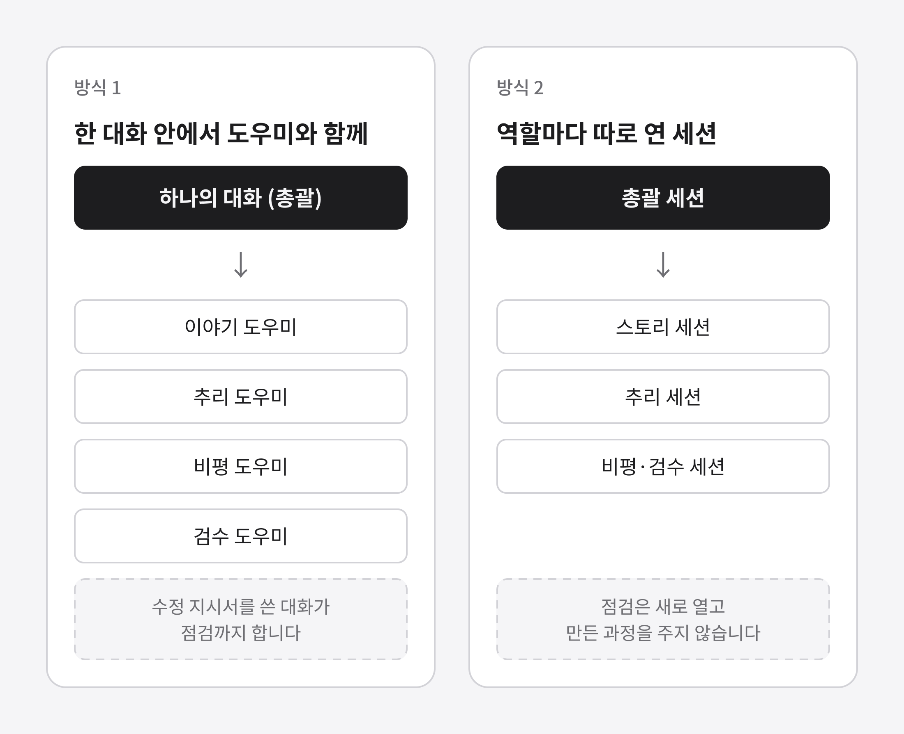
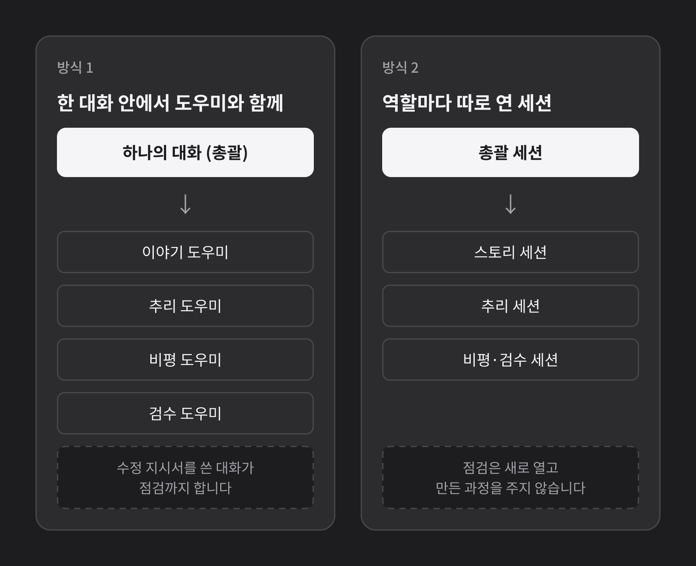
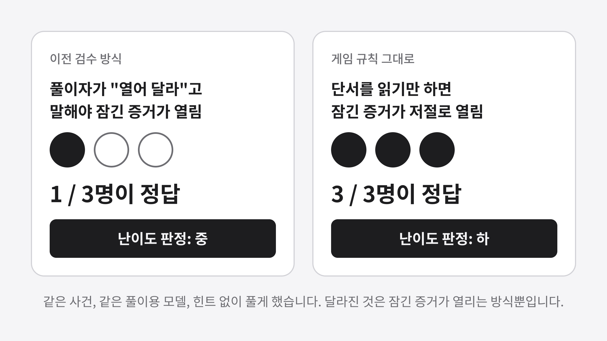
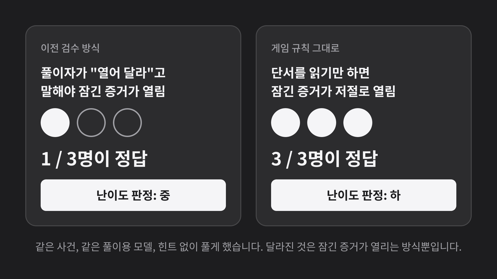
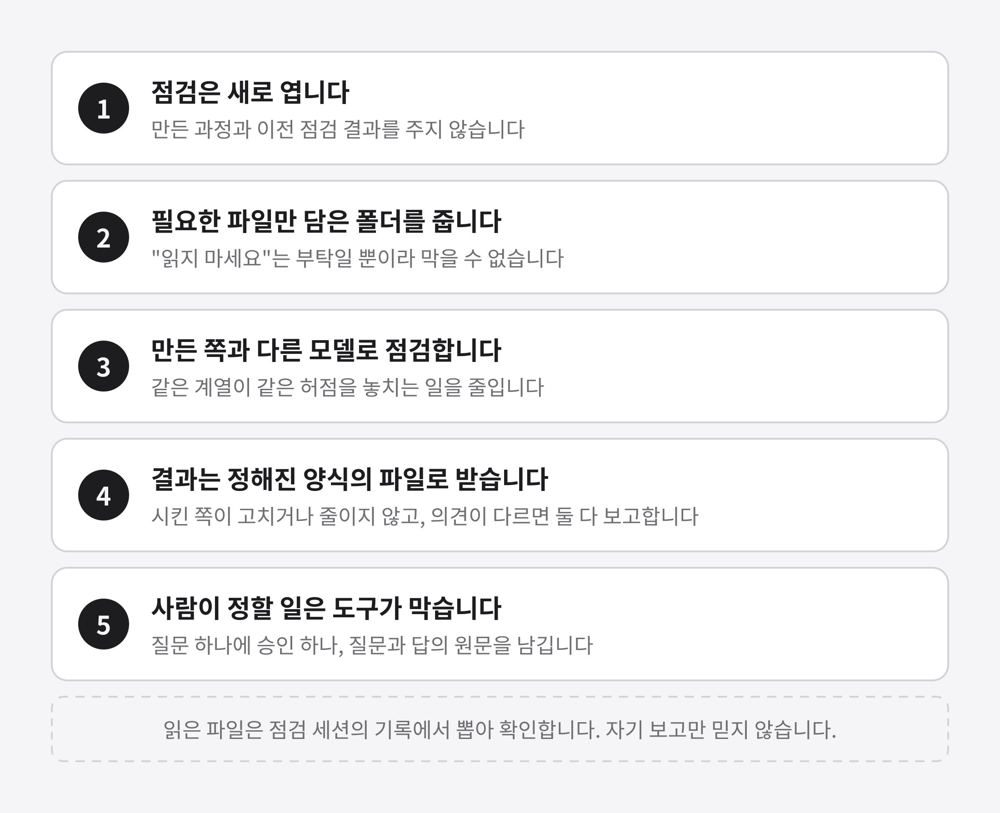
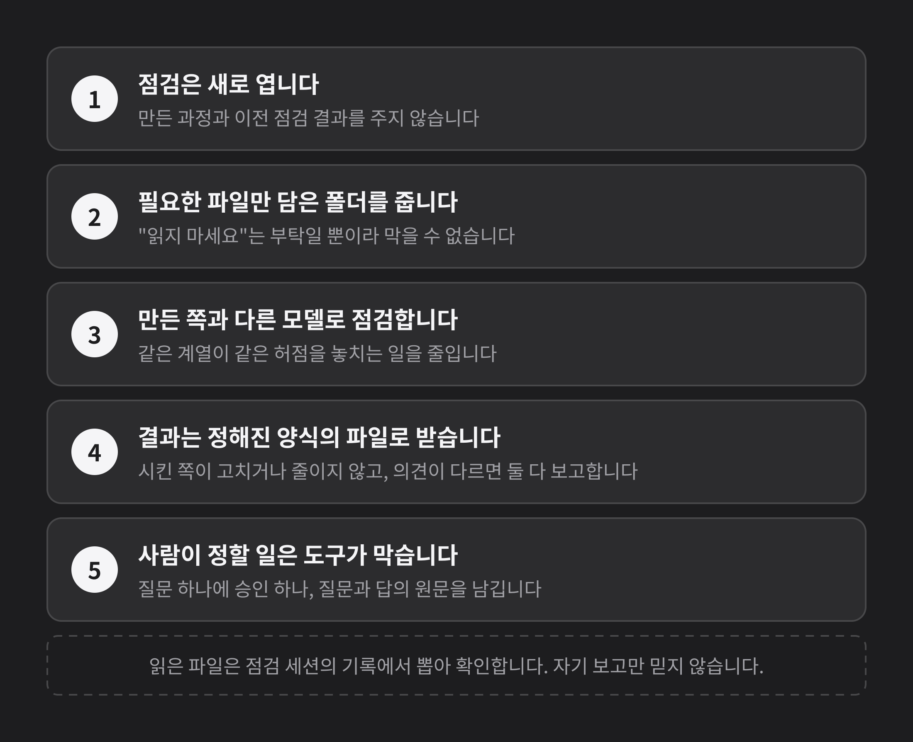

## 개요

사건 만들기 도구를 쓰는 사람은 한 대화에서 사건을 만들어야 합니다. 그래서 세 번째 사건을 한 대화가 도우미를 불러 끝까지 만들게 해 보았습니다. 만든 사건은 이야기, 추리, 비평/검수 세션이 따로 검수했고, 그 결과로 점검 규칙과 도구를 고쳤습니다. 사건은 아직 공개 전이라 내용은 쓰지 않습니다.

## 한 대화와 역할 세션을 견주어 보기

지금은 이야기, 추리, 비평/검수를 서로 다른 세션이 맡습니다. 한 세션이 자기 글을 점검하면 같은 허점을 놓치기 쉽기 때문입니다. 이번에는 한 대화가 도우미를 불러 모든 일을 하게 한 뒤, 그 결과를 세 세션이 서로의 결과를 보지 않고 읽었습니다.

도구 검사는 모두 통과했습니다. 그런데 세 세션이 꼭 고쳐야 한다고 지적한 건수는 각각 3건, 3건, 7건이었습니다. 세는 방식이 달라서 숫자를 그대로 견주지는 않습니다. 세 세션이 똑같이 짚은 문제는 다음과 같습니다.

| 문제 | 무슨 일이었나 |
|---|---|
| 만든 쪽이 점검까지 함 | 앞뒤가 맞는지 보는 스물일곱 항목 중 일곱 개가 외부 판정과 달랐고, 모두 더 너그러운 쪽이었습니다 |
| 고친 판을 다시 점검하지 않음 | 고칠 때마다 비평이 다시 읽지 않았는데 "비평을 통과했다"고 적혔습니다 |
| 횟수 한도를 느슨하게 풀이함 | 세 번 고쳐도 안 풀리면 멈추고 보고하는 규칙을 넘어갔습니다 |
| 사람 확인이 형식에 가까움 | 제가 고른 선택지가 모두 세션이 추천한 것이었습니다 |

## 시험 방식 하나가 난이도를 바꾼 것 확인하기

검수 안내서는 풀이자가 "열어 달라"고 말해야 잠긴 증거를 열어 주게 되어 있었습니다. 게임에서는 단서를 읽기만 해도 저절로 열립니다. 이 차이 때문에 난이도가 목표인 "중"으로 나왔는데, 게임 규칙대로 다시 시험하자 풀이용 모델 세 명이 모두 맞혔습니다.

> **중요:** 도구 검사를 통과해도 설계의 구조 문제는 남을 수 있습니다. 이번에는 독립된 점검과 게임 규칙대로 한 풀이 시험이 그 문제를 찾았습니다.

## 편향을 줄이는 규칙과 도구 만들기

편향은 "도우미냐 세션이냐"가 아니라, 누가 기준을 정하고 누가 점검하고 점검하는 쪽이 무엇을 보느냐에서 생겼습니다. 그래서 점검 규칙 다섯 가지를 정했습니다.

규칙을 지키게 하는 도구도 만들었습니다.

| 도구 | 하는 일 |
|---|---|
| 이야기 검사 | 잠그기 전에 이야기 파일의 형식, 날짜와 요일, 시간표 번호를 확인합니다 |
| 열람형 풀이 도구 | 게임 규칙대로 잠긴 증거가 열리는 상태를 만들어 검수에 씁니다 |
| 진행 관문 | 수정 횟수, 사용자 승인, 필수 파일이 없으면 다음 단계로 못 가게 합니다 |
| 읽은 파일 확인 | 점검 세션이 실제로 연 파일을 세션 기록에서 뽑아 금지 목록과 견줍니다 |

> **참고:** 읽은 파일 확인을 이번 검수에 돌려 보니, 검수 도우미는 지시받은 파일만 열었다는 것이 자기 보고가 아니라 기록으로 확인됐습니다.

## 사건 만들기 도구의 총괄 역할 정하기

사건 만들기 도구를 쓰면 그 대화가 총괄을 맡고 역할 세션을 두게 하는 안내 초안을 썼습니다. 쓸 수 있는 환경에 따라 세 방식으로 나눴습니다. 세션을 스스로 열 수 있는 환경, 사용자가 세션을 열고 메시지로 일을 맡기는 환경, 대화만 있는 환경입니다.

> **참고:** 세션이 스스로 새 세션을 여는 기능은 공식 문서에서 확인하지 못했습니다. 사건 하나를 이 방식으로 더 만들어 시험한 뒤 서버에 반영합니다.

## 결과와 남은 과제

| 항목 | 상태 |
|---|---|
| 한 대화와 도우미로 만들어 보기 | 끝. 끝까지 만들 수 있었지만 점검은 독립된 세션이 필요했습니다 |
| 점검 규칙, 역할 안내, 도구 | 정리했습니다. 새 사건부터 적용합니다 |
| 이 사건 | 꼭 고칠 곳을 고치는 중입니다. 직접 풀어 보기, 사진, 업로드 심사가 남았습니다 |
| 세션이 세션을 여는 기능 | 확인하지 못했습니다 |
| 사건 만들기 도구에 반영 | 새 사건으로 시험한 뒤 진행합니다 |
