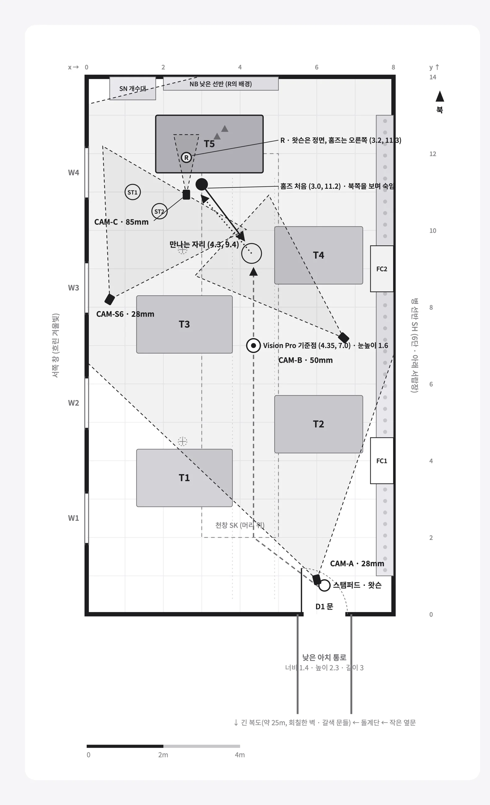
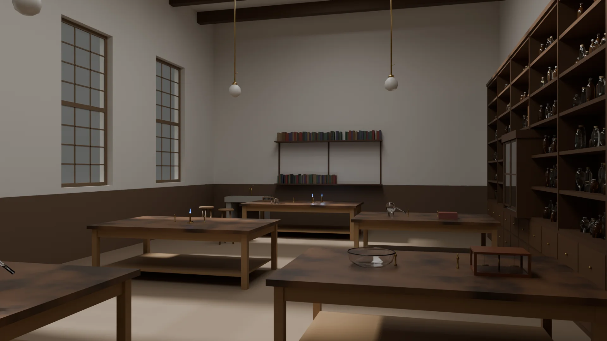
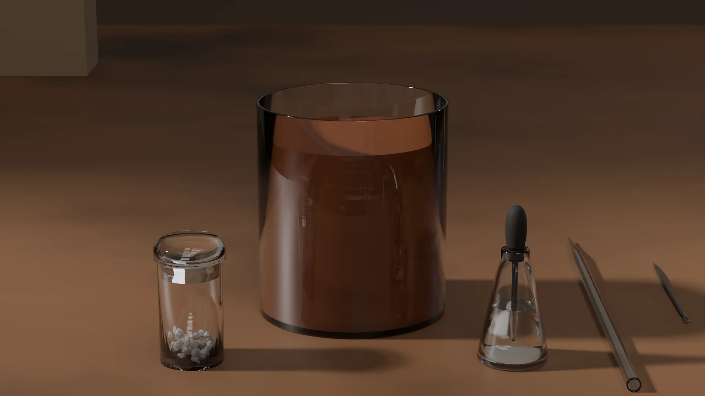

## 개요

10월 24일에는 첫 장편 사건 「주홍색 연구」의 현장을 3D 공간으로 세웠습니다. 원작과 시대 고증을 바탕으로 현장을 글로 설계하고, 디자인 세션이 평면도 · 카메라 · 기준 그림을 그렸습니다. 마지막에는 Blender 작업을 AI 세션에 맡겨 렌더 그림까지 받아 봤습니다. 운영자는 Blender를 다룰 줄 모르는 채로 시작했습니다.

## 그림보다 공간을 먼저 정하기

장편에는 같은 방을 여러 번 보여 주는 그림과 영상이 들어갑니다. AI에게 그림을 따로따로 부탁하면 그림마다 계단 위치가 바뀌거나, 벽에 남은 글씨의 자리가 달라질 수 있습니다. 추리 게임에서 이런 차이는 단서를 망가뜨립니다.

그래서 그림을 만들기 전에 현장을 3D 공간으로 먼저 고정하기로 했습니다. 운영자가 처음 남긴 지시는 이랬습니다.

> "사건 현장에 대해 글로만 정리하는 게 아니라 확실하게 3D 환경으로 정리가 되어야 이미지 만들 때 오류가 없을 거 같아."

## 원작과 시대를 고증해 현장을 글로 설계하기

사건 담당 세션이 현장마다 공간 명세를 썼습니다. 방 크기, 문 · 창 · 계단 · 벽난로 위치, 소품 자리, 조명 방향, 시간대와 날씨를 미터 단위로 적었습니다. 문장마다 근거가 어디서 왔는지 표시했습니다.

| 표시 | 뜻 |
|---|---|
| [원작] | 소설 본문에 나오는 사실 |
| [고증] | 1881년 무렵 런던의 건물 · 실내 · 생활에 관한 자료. 출처를 함께 적습니다 |
| [게임 틀] | 원작에도 고증에도 없어서 새로 정한 것. 지어낸 것임을 밝혀 둡니다 |

날씨는 1881년 3월의 실제 기상 기록을 따랐습니다. 베이커 거리 221B는 당시 없던 번지라, 그 구간에 남아 있는 1815년 무렵의 집을 기준으로 삼았습니다.

## 디자인 세션이 평면도와 카메라를 그리기

디자인 세션은 명세를 받아 평면도, 카메라 표, 기준 그림을 만들었습니다. 카메라마다 위치 · 방향 · 화각을 정해 두어서, 나중에 어떤 도구로 그려도 같은 자리에서 같은 구도가 나옵니다.

기준 그림은 한 시점마다 덩어리 · 깊이 · 선 세 장으로 뽑았습니다. 이 세 장이 이후 AI 그림의 뼈대가 됩니다.

## Blender 작업을 맡기기까지

디자인 세션은 현장마다 3D 설계도 묶음도 만들었습니다. 장면 데이터, 그 데이터로 방의 뼈대와 카메라를 세우는 Blender 스크립트, 소품마다 ChatGPT에 넣을 글이 들어 있습니다. ChatGPT에게 모델을 직접 빚게 하는 대신, 치수를 지키는 Blender 스크립트를 쓰게 하는 방식을 골랐습니다.

운영자가 Blender를 설치해 직접 실행하자 문제가 몇 가지 드러났습니다.

| 문제 | 원인과 해결 |
|---|---|
| 스크립트가 재질을 만들다 멈춤 | 한국어 화면에서는 재질 노드 이름도 번역됩니다. 이름 대신 종류로 노드를 찾게 고치고, 이후 확인은 기본 설정과 한국어 화면 두 환경에서 했습니다 |
| 위에서 방 안이 보이지 않음 | 천장을 따로 묶어 작업 화면에서만 숨겼습니다. 렌더에는 천장이 남아 빛과 그림자가 맞습니다 |
| 누워야 할 소품이 서 있고, 선반 위 병이 판에 묻힘 | 소품을 놓는 스크립트가 소품의 실제 크기와 선반 판 윗면을 재서 맞추게 고쳤습니다 |

세 번째 문제는 운영자가 직접 렌더를 보다가 찾았습니다. 하지만 소품을 하나씩 만들고 놓는 일은 여전히 어려웠습니다. 그래서 역할을 다시 나눴습니다.

> "Blender 내가 직접 하기엔 너무 어렵다. 나를 대신할 수 있는 영역과 내가 직접 해야 하는 영역을 다시 정해서 진행해 보자."

| 누가 | 하는 일 |
|---|---|
| 3D 담당 세션 | Blender 연결 도구로 소품을 만들고 놓고 고치고, 렌더와 3D 파일을 내보냅니다 |
| 디자인 세션 | 도안 · 장면 데이터 · 소품 놓기 스크립트를 맡고, 렌더를 기준 그림과 대조해 검수합니다 |
| 운영자 | 렌더를 보고 "좋다" 또는 "고쳐"만 답하고, 유료 자료를 쓸 때만 승인합니다 |

프롤로그의 시약 장면은 병 하나에 값 하나를 두고, 그 값으로 맑은 물과 적갈색 사이를 오가게 만들었습니다. 같은 장면에서 반응 전과 반응 뒤를 둘 다 뽑을 수 있어, 티저 영상의 색이 변하는 순간에 그대로 씁니다.

> **참고:** 인물은 3D로 만들지 않습니다. 3D 공간은 배경과 소품의 자리를 고정하는 데만 쓰고, 인물은 그림으로 그립니다.

## 결과와 남은 과제

| 항목 | 상태 |
|---|---|
| 현장 공간 명세 4곳(실험실 · 본편 현장 3곳) | 완료 |
| 평면도 · 카메라 표 · 기준 그림 | 4곳 완료 |
| 3D 설계도 묶음 | 4곳 완료, 두 환경에서 실행 확인 |
| 실험실 Blender 렌더 | 진행 중 |
| 본편 현장 3곳 Blender 렌더 | 예정 |
| 티저 영상 | 실험실 렌더가 끝나면 시작 |
