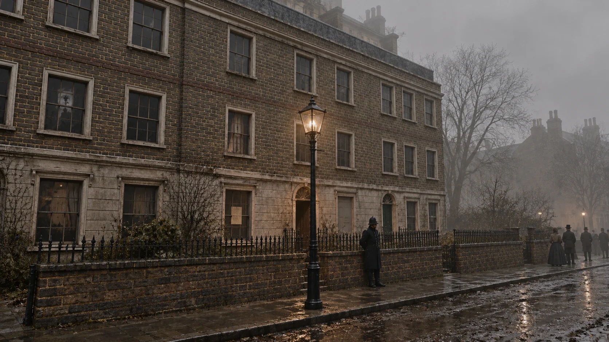
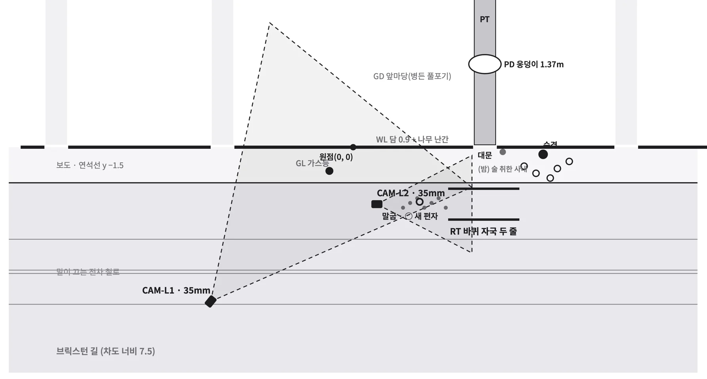
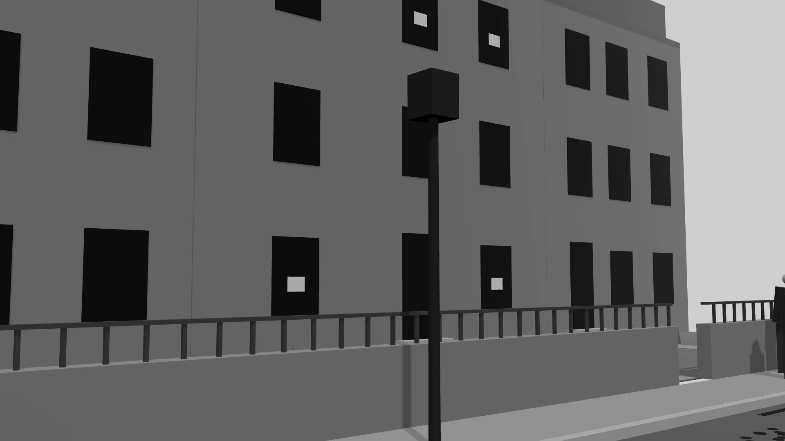
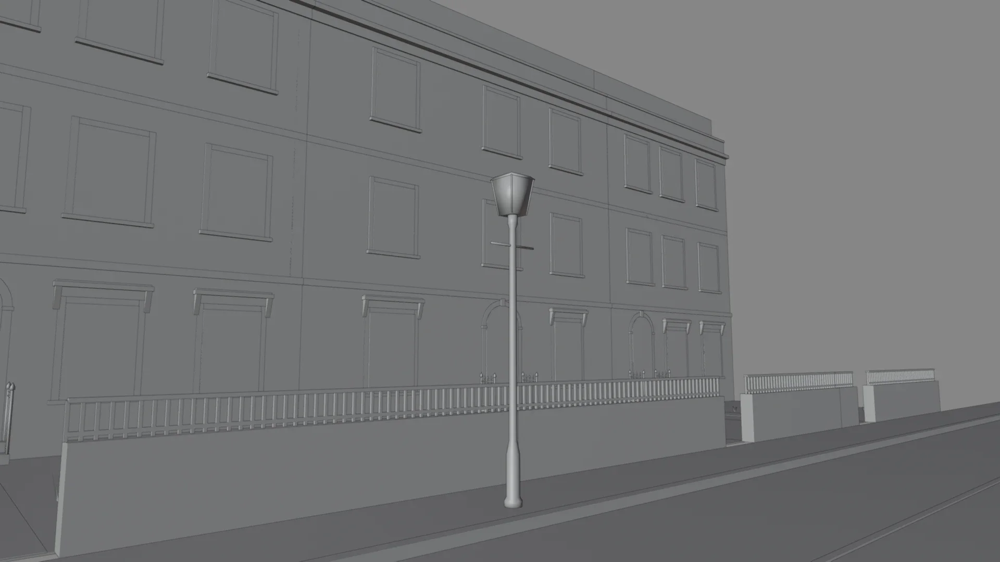
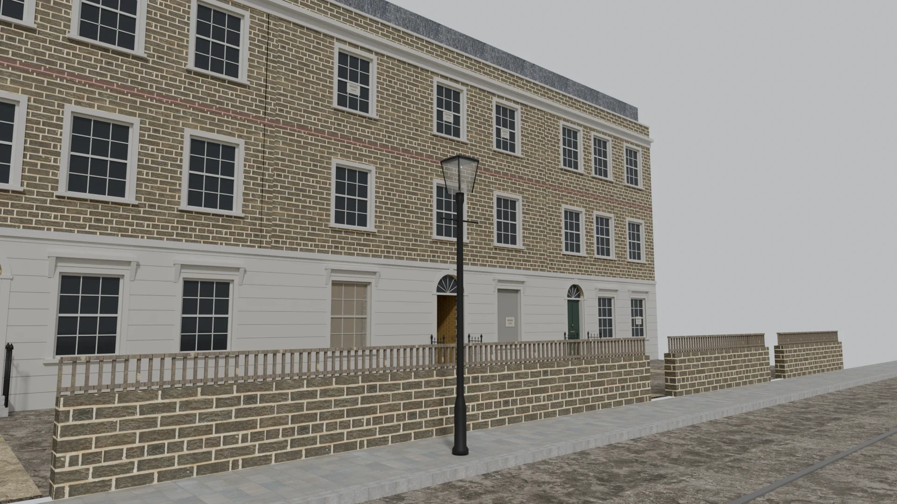

## 개요

첫 장편 사건 「주홍색 연구」에는 같은 장소가 여러 번 나옵니다. 1장 장 그림에 나온 집이 증거 그림과 영상에서 다시 나오고, 같은 방을 다른 각도에서 보여 주기도 합니다. 생성 이미지를 한 장씩 따로 부탁하면 그림마다 창 개수, 가스등 위치, 문 모양이 조금씩 바뀝니다. 추리 게임에서 이런 차이는 단서를 망가뜨립니다.

그래서 이미지를 생성하기 전에 장소를 3D로 먼저 고정했습니다. 이 글은 그 과정을 다섯 단계로 나눠, 다른 개발자도 같은 방식으로 시도해 볼 수 있게 정리합니다. 운영자는 Blender를 다룰 줄 모르는 채로 시작했고, 단계마다 AI 세션에 일을 나눠 맡겼습니다.



## 전체 흐름

| 단계 | 누가 | 결과물 |
|---|---|---|
| 1. 장소를 글로 설계하기 | 사건 담당 세션 | 방 크기 · 문 · 창 · 소품 자리 · 조명 · 시간대를 미터 단위로 적은 공간 명세 |
| 2. 카메라와 기준 그림 그리기 | 디자인 세션 | 평면도, 카메라 표, 시점마다 기준 그림 세 장 |
| 3. Blender로 장면 만들기 | 3D 세션 | 장면 파일과 렌더 |
| 4. 생성 이미지 만들기 | 운영자(ChatGPT) | 렌더를 바탕으로 한 최종 그림 |
| 5. 검수하기 | 디자인 세션 | 통과 · 다시 뽑기 판정과 고쳐 달라는 글 |

운영자가 직접 손을 쓰는 곳은 4단계와, 단계마다 결과를 보고 "좋다" 또는 "고쳐"라고 답하는 일뿐입니다.

## 1. 장소를 글로 설계하기

그림보다 먼저 장소를 글로 정합니다. 사건 담당 세션에게 장소마다 공간 명세를 쓰게 하고, 문장마다 근거를 표시하게 했습니다.

| 표시 | 뜻 |
|---|---|
| [원작] | 소설 본문에 나오는 사실 |
| [고증] | 그 시대 건물 · 생활에 관한 자료. 출처를 함께 적습니다 |
| [게임 틀] | 원작에도 고증에도 없어서 새로 정한 것 |

> **참고:** 명세에 근거 표시를 붙여 두면, 나중에 렌더나 생성 이미지가 이상할 때 "원래 무엇이 맞는지"를 바로 확인할 수 있습니다.

## 2. 카메라와 기준 그림 그리기

디자인 세션은 명세를 받아 평면도와 카메라 표를 그렸습니다. 카메라마다 위치, 방향, 렌즈(mm), 화각을 정해 둡니다. 이렇게 하면 어떤 도구로 그려도 같은 자리에서 같은 구도가 나옵니다.



카메라 하나마다 기준 그림 세 장(덩어리 · 깊이 · 선)을 뽑았습니다. 가장 단순한 모양으로 "무엇이 어디에, 얼마나 크게 보이는지"만 보여 주는 그림입니다.



디자인 세션에게는 이렇게 요청했습니다.

```text
공간 명세를 보고 이 장소의 평면도와 카메라 표를 만들어 줘.
- 카메라마다 위치(x, y, 높이 m), 바라보는 곳, 렌즈 mm, 가로 화각을 적어 줘.
- 평면도에 카메라 시야를 부채꼴로 그려 줘.
- 카메라마다 덩어리 · 깊이 · 선 기준 그림을 1920×1080으로 뽑아 줘.
```

## 3. Blender로 장면 만들기

처음에는 운영자가 Blender 스크립트를 직접 실행했지만, 소품을 하나씩 만들고 놓는 일이 너무 어려웠습니다. 그래서 Blender에 연결 도구(MCP 애드온)를 켜고, 3D 세션이 Blender를 직접 다루게 했습니다. 3D 세션은 명세와 카메라 표를 보고 건물, 담장, 가스등, 길을 만들고 같은 카메라를 세웠습니다.



재질과 조명을 입혀 렌더하면 이렇게 됩니다.



이 단계에서 겪은 문제와 해결은 이렇습니다.

| 문제 | 해결 |
|---|---|
| 한국어 화면에서는 재질 노드 이름도 번역돼서 스크립트가 멈춤 | 이름 대신 노드 종류로 찾게 했습니다 |
| 같은 카메라 이름인데 렌즈 값이 둘(35mm, 24mm) | 장 그림용으로 같은 자리에서 렌즈만 넓힌 카메라를 따로 만든 것이었습니다. 카메라 표에 함께 적어 둡니다 |
| 렌더에서 벽난로가 뒷문처럼 보임 | 운영자가 렌더를 보고 짚었고, 화격자 모양을 다시 만들어 렌더했습니다 |

> **중요:** 렌더는 최종 그림이 아니라 기준입니다. 렌더에서는 공간, 소품 자리, 구도가 맞는지만 봅니다. 질감과 분위기는 다음 단계에서 정합니다.

## 4. 생성 이미지 만들기

디자인 세션은 그림마다 묶음을 만들었습니다. 렌더 한 장, ChatGPT에 붙일 글 한 편, 검수할 때 볼 확인 목록입니다. 글은 늘 같은 틀로 씁니다. 아래는 그 틀을 줄인 예입니다.

```text
Please generate one image based on the attached reference. Wide landscape 16:9.
IMPORTANT: the attached image is a 3D reference render. Keep its composition,
camera, perspective and framing EXACTLY. Do not move, add or remove objects.
Treat the render only as layout; replace its plain surfaces with real materials.

Style: photorealistic still from a period film set in London, 1881.
Scene: a terrace house behind a low brick wall on a foggy March morning.
Must be visible: the front door in the centre, the gas lamp, a constable by the wall.
Do NOT draw: readable text, modern objects, a dog.
Render in natural colour. (A sepia tone is added afterwards.)
```

틀에서 지킨 원칙은 네 가지입니다.

- **렌더를 구도로만 쓰게 하기:** "구도는 그대로, 표면은 실제 재질로"를 맨 앞에 둡니다.
- **꼭 있을 것과 넣지 말 것을 나눠 적기:** 단서가 되는 물건은 "Must be visible"에, 장면을 망치는 것은 "Do NOT draw"에 적습니다.
- **색은 원래 색으로 받기:** 세피아 톤은 나중에 모든 그림에 같은 값으로 입힙니다. 그림마다 톤이 달라지지 않습니다.
- **비슷한 그림은 한 대화창에서 뽑기:** 장 그림끼리, 증거끼리, 인물끼리 한 대화창에서 이어 뽑으면 느낌이 맞습니다.

그림 결은 정하기 전에 샘플로 비교했습니다. 같은 렌더에 "사진 결" 글과 "19세기 삽화 결" 글을 한 줄만 바꿔 뽑아 보고, 사진 결로 정했습니다.

> **참고:** 사건 그림은 이미지 생성 도구의 폭력 표현 차단에 걸리기 쉽습니다. 장면은 그대로 두고 낱말을 순화하고("짙은 적갈색 얼룩", "시트 아래 형체"), "고전 소설 각색 삽화이고 잔인한 장면은 없음"이라는 한 줄을 맨 앞에 더했습니다. 올리는 파일 이름도 읽히니 번호만 쓰는 게 안전합니다.

## 5. 검수하기

생성한 그림은 디자인 세션이 원본 크기로 확대해서 확인 목록과 대조합니다.

| 항목 | 보는 것 |
|---|---|
| 구도 | 렌더와 겹쳐 봤을 때 벽 · 창 · 문 · 큰 가구 선이 맞는지 |
| 꼭 있을 것 | 단서 물건이 빠지지 않았는지 |
| 넣지 말 것 | 금지한 물건이 생기지 않았는지 |
| 글씨 | 읽히는 글씨가 없는지 |
| 품질 | 손 · 얼굴 · 비율 · 질감이 자연스러운지 |

떨어진 그림에는 같은 대화창에 붙일 짧은 글을 함께 받습니다. "이 그림은 그대로 두고 이 세 가지만 바꿔 줘" 형식입니다. 첫 판에서는 26장 중 10장이 바로 통과했습니다. 떨어진 그림 가운데 몇 장은 운영자가 보고 그대로 쓰기로 했습니다.

> **중요:** 생성 도구는 단서가 되는 작은 디테일을 자주 바꿉니다. 글씨 모양, 물건의 색, 개수 같은 것입니다. 단서 그림은 두세 번 다시 뽑을 각오를 하고, 검수에서 그 부분을 따로 확인하세요.

## 정리

| 단계 | 핵심 |
|---|---|
| 글로 설계 | 근거를 표시해 두면 나중에 무엇이 맞는지 바로 확인할 수 있습니다 |
| 카메라 · 기준 그림 | 카메라 값을 숫자로 정해 두면 도구가 바뀌어도 구도가 같습니다 |
| Blender | 연결 도구로 AI 세션이 Blender를 다루게 하고, 렌더는 기준으로만 봅니다 |
| 생성 이미지 | 같은 틀의 글, 원래 색으로 받기, 비슷한 그림은 한 대화창에서 |
| 검수 | 확인 목록으로 원본 크기에서 보고, 고쳐 달라는 글을 함께 남깁니다 |

3D 장면은 한 번 만들어 두면 다른 카메라로 몇 장이든 다시 뽑을 수 있습니다. 같은 장소가 여러 번 나오는 이야기라면, 그림을 만들기 전에 공간부터 고정해 보세요.
